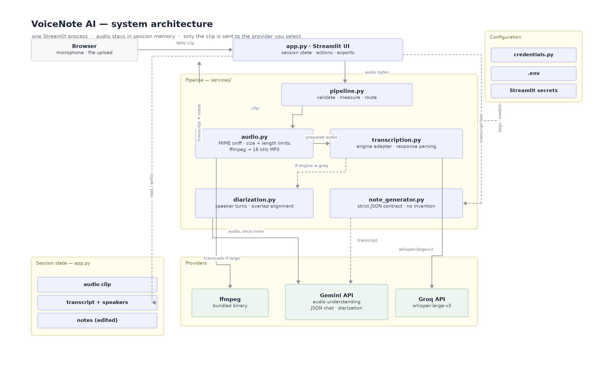
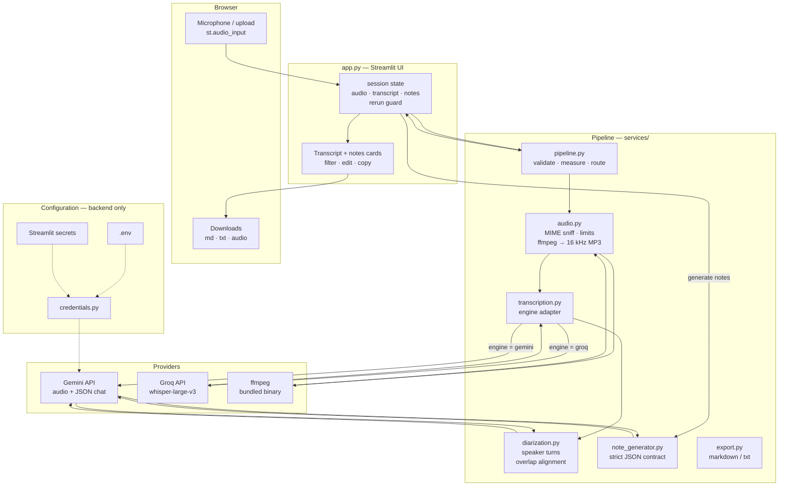
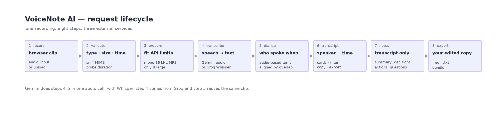

# VoiceNote AI

**Record a conversation → get a speaker-labelled transcript → get structured meeting notes → export.**

A compact GenAI project for a university / college course demonstration. Streamlit front end,
Google Gemini and Groq Whisper behind it, no database, no login, nothing written to disk.



---

## Contents

1. [What it does](#1-what-it-does)
2. [Architecture](#2-architecture)
3. [Project structure](#3-project-structure)
4. [Quick start](#4-quick-start)
5. [Configuration](#5-configuration)
6. [Providers and limits](#6-providers-and-limits)
7. [Deployment](#7-deployment-streamlit-community-cloud)
8. [Testing](#8-testing)
9. [Troubleshooting](#9-troubleshooting)
10. [Limitations](#10-limitations)
11. [Privacy](#11-privacy)
12. [Presentation script](#12-presentation-script)

---

## 1. What it does

| Step | What happens | Honest detail |
| --- | --- | --- |
| **Record** | Browser records a clip (`st.audio_input`) or you upload a file | One finished clip, **not** word-by-word streaming |
| **Transcribe** | Gemini audio understanding, or Groq Whisper | Real provider output; no mock text anywhere |
| **Identify speakers** | Gemini listens to the audio and returns speaker turns, aligned to the transcript by timestamp overlap | Anonymous clusters (`Speaker 1`, `Speaker 2`), never identities |
| **Review** | Card transcript with speaker colours, timestamps, per-speaker filter, copy button | Segments keep their order; consecutive lines merge for readability |
| **Generate notes** | Gemini writes title, summary, topics, key takeaways, decisions, action items and open questions as strict JSON | Prompt forbids inventing content; missing sections say so |
| **Edit & export** | Every field is editable, exports use the edited values | Notes `.md` / `.txt`, transcript `.md` / `.txt`, bundle, optional audio |

Guiding rule: **nothing is faked.** Where a capability is unavailable the app says so instead of
imitating it.

---

## 2. Architecture

### 2.1 Diagram (GitHub-rendered)



### 2.2 Component roles

| Layer | Module | Responsibility |
| --- | --- | --- |
| UI | `app.py` | Layout, session state, button actions, export wiring — **no provider code** |
| UI | `components/recording.py` | Microphone / upload control → `Capture(data, filename, source)` |
| UI | `components/transcript_view.py` | Speaker legend, filter pills, transcript rows |
| UI | `components/notes_view.py` | Notes preview + inline editor (edits flow back into exports) |
| UI | `components/layout.py`, `styles.py` | Brand header, status chip, stepper, card headers, design tokens |
| Domain | `services/models.py` | `Segment`, `SpeakerTurn`, `Transcript`, `Notes` — dataclasses, grouping, renderers |
| Pipeline | `services/pipeline.py` | Validate → measure → transcribe → diarize, plus the caching signature |
| Speech | `services/transcription.py` | Gemini and Groq adapters, response parsing, friendly errors |
| Speech | `services/diarization.py` | Gemini speaker turns, overlap-based alignment to any transcript |
| LLM | `services/note_generator.py` | Prompt, JSON contract, tolerant parsing of model output |
| Transport | `services/gemini.py` | The only module importing `google-genai`: timeouts, retries, model discovery |
| Audio | `services/audio.py` | MIME sniffing, size/duration limits, compression with ffmpeg |
| Config | `services/config.py`, `credentials.py` | Key resolution (`.env` → secrets → code), models, limits |
| Output | `services/export.py` | Markdown / plain-text builders and safe file names |

### 2.3 Request lifecycle



```
clip ─► build_payload()          validate extension, size, sniff MIME, probe duration
      ─► prepare_for_provider()  small → send as-is · large → ffmpeg mono 16 kHz MP3
      ─► transcription
            engine = gemini  → one generateContent call → {segments[{start,end,speaker,text}]}
            engine = groq    → transcriptions.create(verbose_json) → segments[]
                               then Gemini diarization → turns[] → align by overlap
      ─► canonicalize_speakers()  relabel Speaker 1..N by first appearance
      ─► Transcript in session state ─► cards, filter, copy, exports
      ─► (explicit action) generate_notes() ─► JSON ─► editable preview ─► downloads
```

Regenerate both images with `python docs/render_architecture.py` (dev-only, needs matplotlib).
The Mermaid block above is rendered by GitHub itself, so the diagram stays readable even without
the PNG.

---

## 3. Project structure

```
VoiceNote-AI/
├── app.py                          # Streamlit UI + orchestration
├── components/
│   ├── recording.py                # microphone / upload
│   ├── transcript_view.py          # legend, filter, rows
│   ├── notes_view.py               # preview + editor
│   ├── layout.py                   # header, status chip, stepper
│   └── styles.py                   # design tokens + CSS
├── services/
│   ├── credentials.py              # optional in-code keys/settings
│   ├── config.py                   # key + model resolution
│   ├── audio.py                    # validation, duration, ffmpeg
│   ├── transcription.py            # Gemini / Groq adapters
│   ├── diarization.py              # speaker turns + alignment
│   ├── note_generator.py           # prompt + JSON guardrails
│   ├── gemini.py                   # google-genai wrapper
│   ├── pipeline.py                 # end-to-end orchestration
│   ├── export.py                   # markdown / txt
│   ├── models.py                   # dataclasses
│   ├── json_utils.py               # tolerant JSON parsing
│   └── errors.py                   # message + hint errors
├── docs/
│   ├── architecture.png
│   └── render_architecture.py
├── tests/
│   ├── test_units.py               # 24 tests, no network
│   └── test_provider_contract.py   # 4 request-shape tests
├── .streamlit/config.toml          # theme, upload limit
├── requirements.txt                # pinned runtime deps
├── requirements-dev.txt            # pytest + ruff
├── runtime.txt                     # python-3.11 for Cloud
└── .env.example
```

---

## 4. Quick start

### Windows PowerShell

```powershell
git clone https://github.com/<your-user>/Voice-To-Note.git
cd Voice-To-Note

py -3.11 -m venv .venv
.\.venv\Scripts\Activate.ps1
# blocked by policy? run once: Set-ExecutionPolicy -Scope Process -ExecutionPolicy Bypass

pip install -r requirements.txt

Copy-Item .env.example .env
notepad .env          # paste GEMINI_API_KEY (and GROQ_API_KEY if you want Whisper)

streamlit run app.py
```

### macOS / Linux

```bash
python3.11 -m venv .venv && source .venv/bin/activate
pip install -r requirements.txt
cp .env.example .env && $EDITOR .env
streamlit run app.py
```

Open <http://localhost:8501>. `localhost` counts as a secure context, so the microphone works
without HTTPS. ffmpeg needs no manual install — `imageio-ffmpeg` ships a static binary.

---

## 5. Configuration

**Backend only** — the interface never displays keys, provider names or environment variables.

Resolution order: `.env` / environment → Streamlit secrets → `services/credentials.py`.

```python
# services/credentials.py
GEMINI_API_KEY = ""        # https://aistudio.google.com/apikey
GROQ_API_KEY = ""          # https://console.groq.com/keys
GEMINI_MODEL = ""          # empty = gemini-2.5-flash
GROQ_MODEL = ""            # empty = whisper-large-v3-turbo
TRANSCRIPTION_ENGINE = ""  # "gemini" | "groq"
DIARIZATION = ""           # "auto" | "off"
LANGUAGE = ""              # "auto" | ISO-639-1
```

| Variable | Default | Meaning |
| --- | --- | --- |
| `GEMINI_API_KEY` | – | Required for speaker labels, notes and the Gemini engine |
| `GEMINI_MODEL` | `gemini-2.5-flash` | Any chat model the key exposes |
| `GROQ_API_KEY` | – | Optional Whisper engine |
| `GROQ_MODEL` | `whisper-large-v3-turbo` | or `whisper-large-v3` |
| `TRANSCRIPTION_ENGINE` | `gemini` | `gemini` or `groq` |
| `DIARIZATION` | `auto` | `auto` / `off` |
| `LANGUAGE` | `auto` | ISO-639-1 or `auto` |
| `MAX_UPLOAD_MB` | `200` | Upload guard |
| `MAX_AUDIO_SECONDS` | `3600` | Recording-length guard |
| `STT_TIMEOUT` / `LLM_TIMEOUT` | `120` / `180` | Per-request timeouts (seconds) |

Missing keys never crash the app: recording and existing results keep working and only the
affected action explains what is needed. If one engine has no key the pipeline falls back to the
other automatically.

> Keep `services/credentials.py` out of public repos — a committed key is scraped within minutes.
> `.env` and Streamlit Secrets are already git-ignored.

---

## 6. Providers and limits

| Purpose | Provider | Model | Cost |
| --- | --- | --- | --- |
| Transcription + diarization | Google Gemini API | chat model of your key (default `gemini-2.5-flash`) | Free tier is enough for a demo |
| Optional transcription | Groq | `whisper-large-v3-turbo`, `whisper-large-v3` | Free: 20 req/min, 28.8k audio-s/day |
| Notes | Google Gemini API | same model | Free tier |

Long recordings are compressed to mono 16 kHz MP3 before upload so they stay inside the API caps
(20 MB inline for Gemini, 25 MB for Groq) — verified in testing: a 10-minute 16 kHz WAV
(18.3 MB) becomes ~4.6 MB.

---

## 7. Deployment (Streamlit Community Cloud)

1. Push the repository to GitHub.
2. <https://share.streamlit.io> → **Create app** → repo, branch `main`, main file `app.py`.
3. **Advanced settings → Python 3.11** (the repo ships `runtime.txt`).
4. **Secrets**:

   ```toml
   GEMINI_API_KEY = "..."
   GEMINI_MODEL = "gemini-2.5-flash"
   GROQ_API_KEY = "..."
   GROQ_MODEL = "whisper-large-v3-turbo"
   TRANSCRIPTION_ENGINE = "gemini"
   DIARIZATION = "auto"
   ```

5. Deploy, open the URL (HTTPS), allow the microphone.

No local paths, no runtime model downloads. A sleeping free app needs 30–60 s to wake — open it
before class.

---

## 8. Testing

```bash
pip install -r requirements-dev.txt
python -m compileall -q app.py services components   # syntax / imports
ruff check .                                         # lint (clean)
python -m pytest -q                                  # 28 tests
streamlit run app.py                                 # boots, /_stcore/health = ok
```

* `tests/test_units.py` (24) — timestamps, segment grouping, speaker renumbering, parsing Gemini
  transcripts / Groq `verbose_json` / diarization turns, overlap alignment, note parsing with empty
  sections, exports, audio validation and duration, missing-key errors, engine fallback.
* `tests/test_provider_contract.py` (4) — a local mock HTTP server asserts the **real requests**:
  inline audio part + MIME type, `responseMimeType: application/json`, system instruction, Groq
  multipart fields, transcript inside the notes prompt, and that a 403 becomes a helpful
  `ProviderError`.

The UI was additionally driven headless with Streamlit's `AppTest` in every state (empty,
transcript, transcript + notes): source switcher, settings popover, speaker filter, live editing →
preview → export, download buttons, rerun persistence, and survival of a failed note generation.

**Needs your credentials / a real microphone:** transcription and diarization accuracy, note
quality and latency, the browser permission flow, provider rate limits.

---

## 9. Troubleshooting

| Symptom | Fix |
| --- | --- |
| "No Google Gemini API key is configured" | Add `GEMINI_API_KEY` to `.env`, Secrets or `services/credentials.py`, then restart Streamlit |
| No speaker labels | Gemini key missing, or *Identify speakers* off in Settings |
| Record control inert / permission denied | Needs HTTPS or `localhost`; grant mic permission; close apps holding the mic |
| "This audio file could not be decoded" | Convert to WAV/MP3/M4A; re-run `pip install -r requirements.txt` for the ffmpeg wheel |
| 429 from Gemini or Groq | Free-tier limit — wait a minute, shorten the clip, or switch provider |
| Model errors after switching model | That model is not available to your key; reload and pick from the list |
| Notes fail | The transcript is kept; press Generate again or export the transcript |

---

## 10. Limitations

1. **Clip-based, not streaming.** The recorder uploads one finished clip; transcription starts when
   you press stop. No interim text is simulated.
2. **Speakers are anonymous clusters.** Similar voices can merge; crosstalk can be mis-assigned.
3. **Diarization runs after recording**, because it needs the whole clip.
4. **Gemini's diarization is model judgement**, not a dedicated speaker-embedding pipeline; two to
   four clear speakers work well.
5. **Whisper alone has no diarization** — without a Gemini key transcripts have no speaker labels.
6. **Transcription errors propagate** into the notes; the transcript stays visible to check.
7. **Free-tier limits** apply; very long recordings should be split.

---

## 11. Privacy

* Audio is sent only to the provider(s) you configure.
* Recordings live in session state; nothing is written to the repo or disk (temporary files exist
  only during ffmpeg conversion and are deleted immediately).
* `.gitignore` excludes `.env`, `secrets.toml`, keys and audio files.
* Keys are never logged, rendered, or included in error messages.

---

## 12. Presentation script

> "VoiceNote AI is a Streamlit app that turns a recorded conversation into structured notes. The
> browser records one clip, which goes to Gemini's multimodal audio model — it returns the
> transcript with timestamps and, because it actually listens to the voices, anonymous speaker
> turns: Speaker 1, Speaker 2. Alternatively Whisper handles the transcription and a second Gemini
> pass supplies speaker turns, aligned by timestamp. The transcript is then sent as text to the LLM
> with a strict JSON contract for summary, decisions and action items, and the prompt forbids
> inventing anything. Everything is editable and exportable as Markdown. The honest limitation is
> that it is clip-based rather than word-by-word streaming: I chose a reliable fallback over a
> fragile live demo."

Likely questions:

* **Is the speaker labelling random?** No — it comes from an audio model analysing voice
  characteristics, then renumbered by first appearance.
* **Why two speech providers?** Reliability and speed; one key failure before class does not stop
  the demo.
* **What if a key is missing?** Only the affected step reports it; results already produced are kept.
* **Why not local Whisper?** Heavy on CPU, no diarization, and unsuited to a free cloud host.
